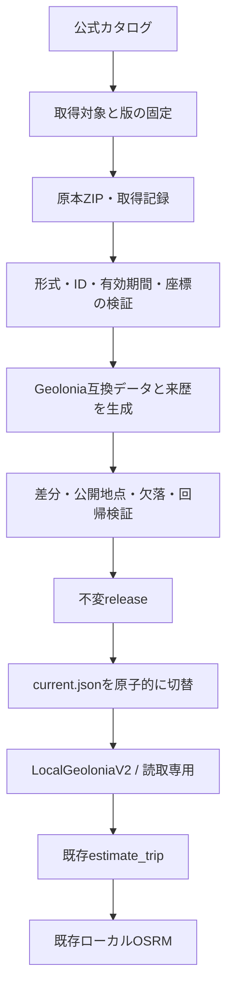

# 最新住所データ対応設計

- 設計版：1.0 / 2026-10-19（日本時間）
- 対応する基本設計：Architecture.md v1.2、14節
- 状態：**対応設計は完成。更新機能・ローカル住所データの構築・切り替えは未実装/未検証**。
- 相談結果：種類ごとに公式の最新公開版を選び、番地・座標との対応を確認できたものを使用する。更新日が異なる場合は各日付を表示し、対応不明な住所は保留する。一律の座標年齢上限は設けない。

## 1. 「最新」の定義と今回の範囲

このシステムでいう最新対応は、**確認した時点の公式カタログで利用可能な最新版を種類・地域ごとに選択し、取得物を固定して検証できること**。現実の全住所が現時点の座標で網羅されることを保証する意味ではない。

次の日時を分ける。

| 情報 | 意味 | 扱い |
|---|---|---|
| catalog_checked_at | カタログを実際に確認した日時 | 最新公開版の選択をいつ確認したか |
| catalog_modified_at | カタログ項目の更新日時 | 原データの測量日・効力日とは限らない |
| provider_declared_updated_at | 提供者が説明等で示す最終更新情報 | 抽出元と原文値も保持し、意味を推測で補わない |
| source_reference_date | 原典の基準日・整備日 | 明示されている場合だけ採用。不明はnull |
| record_effective_date / record_abolished_date | レコードの効力発生日・廃止日 | 現在有効な住所かを判定する |
| coordinate_maintenance_date | 座標の整備日等 | 明示されたレコードだけ保存。カタログ日で埋めない |
| downloaded_at | 原本を取得した日時 | 更新日として表示しない |
| generated_at | 自分のデータセットを生成した日時 | 更新日として表示しない |
| result.fetched_at | 住所を解決/取得した日時 | 元データや座標の鮮度とは別 |

**訂正**：既存Geolonia公開APIの`meta.updated=1735102668/1735102670`は2024-12-25 UTCに相当するが、確認した生成コードはここへ生成時刻を設定する。その値だけから「ABR原本や座標の更新日が2024年12月」とは断定できない。既存結果の`dataset_version`は従来の互換用識別情報として残し、今後の鮮度判定には使わない。

今回作成するのは更新対応の設計・実装順・受入条件。既存CUI、公開関数、稼働中OSRM、利用者のconfig/CSV、既存キャッシュはそのまま。最新版の住所データを実際に構築したという実績にはしない。

## 2. 公式資料と小規模な実応答で確認したこと

デジタル庁の説明では、町字の文字情報は正式版で、町字の地図情報・地番・住居表示は試験公開版。整備状況や基準日が異なる。最新の町字だけ取得しても、番地・号までの座標は揃わない。[デジタル庁の説明](https://www.digital.go.jp/policies/base_registry_address)

2026-10-19に公式カタログのメタデータだけ照会した。以下は提供者の説明欄にある最終更新情報であり、測量日を確認したものではない。

| 対象 | 提供者が記す最終更新日（UTCの日付） | 取得単位 |
|---|---|---|
| 大阪府 町字マスター | 2026-09-17 | 都道府県 |
| 大阪府 町字マスター位置参照拡張 | 2025-10-27 | 都道府県 |
| 大阪府 住居表示-住居マスター | 2025-10-27 | 都道府県 |
| 大阪府 住居表示-住居マスター位置参照拡張 | 2025-10-27 | 都道府県 |
| 大阪市北区 地番マスター | 2026-02-25 | 市区町村 |
| 大阪市北区 地番マスター位置参照拡張 | 2026-06-23 | 市区町村 |

都道府県レベルの「地番マスター」検索で0件でも、自治体単位には存在した。また「大阪市北区」を含む検索には他自治体も返った。**検索の先頭1件や部分一致だけで原本を選択してはいけない**。取得対象の識別情報は`evidence/address_catalog_20261019.json`に保存する。原本ZIPは今回ダウンロードしておらず、実CSVの列・全件の整合性・更新後の解決率は未確認。

Geoloniaツールには一括生成、地域フィルター、Range生成機能がある。ただし、そのまま動かせば最新対応が完成するとは限らない。確認したコードには生成時刻の使用、IDでの結合、既定の別資料補完がある。これらを後述の検証・追跡情報で補う。[公式リポジトリ](https://github.com/geolonia/japanese-addresses-v2)

## 3. 採用する構成

初期実装方針は、**ABR公式原本を取り込み、Geolonia v2と互換なローカルの不変データセットを作る方式**。既存照合ロジックを再利用し、`Geocoder`ポートのローカル実装を追加する。ローカルファイルを読むため、住所データ配信用のHTTPサーバーを常駐させる必要はない。



- 更新ツールだけがカタログや原本配布先へ通信する。顧客CSV・顧客名・顧客コード・顧客住所を更新処理へ渡さない。
- 見積側は起動時にreleaseを一つ選び、そのオブジェクトの使用中は固定する。FromとToで別releaseを使わない。
- 更新処理と見積処理を別プロセスに分ける。更新のために既存サービスを途中で壊さない。
- 元の公開HTTPアダプターはデモ/比較用として明示設定で残す。ローカルデータが壊れても公開APIへ黙って切り替えない。
- 最初は大阪市北区の検証セット、次に大阪府、必要自治体へ段階的に拡大する。近畿全域の住所整備完了を先に宣言しない。OSRMのPBF範囲と住所データの収録範囲は別管理する。
- ABRジオコーダーを直接採用する案は別プロバイダー候補。今回の設計では既存の精度契約・照合処理への変更を小さくする方式を選ぶ。別方式へ変える場合は同じ受入条件で比較する。

## 4. 更新処理とカタログ取得

実装予定のコマンドを以下に固定する。**現時点では存在しないコマンド**であり、実装手順の契約を示す。

```text
python -m route_estimator.address_data discover --scope <自治体一覧.json>
python -m route_estimator.address_data fetch --plan <取得計画.json>
python -m route_estimator.address_data build --plan <取得計画.json>
python -m route_estimator.address_data validate --candidate <候補ID>
python -m route_estimator.address_data activate --candidate <候補ID>
python -m route_estimator.address_data rollback --dataset-id <旧ID>
python -m route_estimator.address_data status
```

### 4.1 discover

公式カタログ`https://dataset.address-br.digital.go.jp/api/search/v1/collections/all/items`を使う。現在の検索仕様は公式API定義に合わせて実装時に固定する。小規模照会でHTTP 200、`features`、`numberMatched`等を確認した。

- リソースの種類・地理的範囲・自治体コードを照合し、カタログIDとURLを取得計画へ固定する。
- 「町字マスター」と「町字マスター（フルセット）」を区別する。現行住所に必要なデータを選び、フルセットを取り込む場合も履歴行の扱いを定義してから使う。
- `limit`はAPI上限以下、`startindex`は仕様に従う。全ページの件数、ID重複、取得漏れを検証し、上限・異常・取得中のカタログ変更を検出したら計画を確定しない。
- 対象地域の一覧を保存する。検索0件と未取得を区別し、対象自治体が抜けた状態を「完了」にしない。
- カタログを更新直前にも再確認する。取得中に対象項目の版が変わった場合は再計画する。確認後の提供者変更は次回確認まで検知できないため、latest-checked-atを必ず残す。
- 同一種類・同一地域で採用候補が複数あり一意に決まらない場合は停止し、候補一覧を相談事項として出す。`modified`が最大の項目を無条件に選ばない。

### 4.2 fetch

- 原本は一時ファイルへストリーム保存し、完了時にファイルサイズ・SHA-256を計算して確定する。
- 小規模照会で確認した配布先は`https://data.address-br.digital.go.jp/`。取得時の接続先はこの用途に必要な許可済みホストに限定する。HTTPリダイレクトも到達先を検証する。新しい配布先は自動許可しない。
- 接続/読込タイムアウト、リトライ上限、圧縮サイズ・展開サイズ・空き容量上限を設定する。上限を超えたときに無制限へ広げず停止する。
- ZIPは絶対パス・`..`・シンボリックリンク等の危険な展開を拒否する。文字コード、CSV必須列、型、未知の状態コードはスキーマ版で検証する。状態コードの意味は正式な定義を確認し、名称から推定しない。
- ETag/Last-Modifiedがあれば記録するが、同一性は原本バイト列のSHA-256でも確認する。HTTPSと許可済み配布元が取得元の根拠、ハッシュは取得後の同一性の根拠。
- 原本のURL、カタログID、カタログ情報、規約参照、取得日時、ハッシュを保存し、後から同じ入力を再現できるようにする。

### 4.3 build

Geoloniaの生成器は**検証済みコミットと依存lockを固定**して利用する。調査時のコミットは`061f250a2bfaf8e7b0465544c7278cdca86793dc`。採用する時点で原本と互換性を検証する必要があり、この調査だけで利用可能と確定しない。

- 通信する取得段階と、固定原本を使う生成段階を分ける。上流の可変URLや古いダウンロードキャッシュを生成中に再利用しないよう、入力解決部分をラップ/必要最小限で修正する。
- 順序は自治体→町字→住居表示/地番→Range再作成→統計。対応する位置参照データも同じ取得計画から読む。
- 確認した上流にはMLITの`17.0b`を補完する既定処理がある。初期ローカルreleaseでは、その補完を既定で無効にする生成プロファイルを実装する。補完を採用するなら資料の版・利用条件・精度を別途保存し、町丁目代表点をEXACT_ADDRESSへ昇格させない。
- 上流生成器が情報を落とす場合は、ID、状態、有効期間、原典・座標の日付をsidecarへ保存し、見積時にも検証できるようにする。文字列CSVだけを残して結合の根拠を失わない。
- 地域限定出力でも、上流の一部段階が広域の原本を読む可能性がある。対象限定できると決めつけず、初回pilotでCPU/RAM/原本/展開後サイズを計測する。OSRMと同時に重い処理を動かさない。

## 5. ID変更・古い座標との整合性

照合単位を、名称だけで結び付けない。

| 対象 | 主な結合キー | 追加の確認 |
|---|---|---|
| 町字文字と位置参照 | `lg_code + machiaza_id` | 現行/履歴、同名町字の識別、原典の整備情報 |
| 住居文字と位置参照 | `lg_code + machiaza_id + blk_id + rsdt_id + rsdt2_id` | 住居表示方式、番地号表記、有効期間 |
| 地番文字と位置参照 | `lg_code + machiaza_id + prc_id` | 地番表記、レコード区分、有効期間 |

上記は調査した型/結合実装による候補。実装時には取得したCSVの正式なスキーマで確定し、存在しない列を捏造しない。

判定順：

1. 型・必須キー・状態コード・座標参照系を検証する。未対応の座標系は推定変換しない。
2. 現在有効な町字・番地号を選ぶ。廃止済・将来有効・状態不明はEXACT_ADDRESSへ入れない。
3. 識別子に加え、下位データにある住所表記・住所方式・有効期間を照合する。キー一致だけで新旧の同一性を保証したことにしない。
4. 複数候補、座標なし、現在の住所への対応が不明なレコードは保留対象にし、品質レポートへ理由を集計する。
5. 町字IDが変わった場合は、公式の修正対応資料が適用できるか検証する。根拠付きの一意な対応だけをcrosswalkへ記録する。曖昧・多対多・資料なしは保留。編集前後が同名という理由だけでIDを付け替えない。
6. 自治体・町字名変更や`字`/`大字`の有無を更新ツールが勝手に同義扱いしない。操作者の住所編集は従来どおり可能だが、それだけで原本間の対応確認済みにしない。

新しい文字と古い位置参照の組合せが、上記で一意に整合すると確認できたときは使用可能。日付差がある事実を結果へ残す。元の整備日が不明なら「座標の整備日不明」と表示し、カタログの更新情報だけを別表示する。古さだけによる一律禁止は行わない一方、日付不明を最新とは表示しない。

## 6. 不変release・来歴・品質レポート

予定配置：

```text
state/address_data/
  plans/<plan-id>.json
  raw/<sha256>/...                 # 取得原本・カタログ記録・規約参照
  staging/<candidate-id>/...
  releases/<dataset-id>/
    manifest.json
    api/ja.json
    api/ja/<pref>/<city>.json
    api/ja/<pref>/<city>-住居表示.txt
    api/ja/<pref>/<city>-地番.txt
    provenance/...                # 原本ID・結合根拠・レコード整備情報
    quality_report.json
  current.json
```

`manifest.json`のpayloadには以下を必須とする。

- manifest/生成形式/照合器・正規化のschema版、生成日時、対象地域のコード一覧、実際に使った取得計画ID。
- 種類ごとの原本一覧：カタログID、URL、各種日時（意味不明/不明はnull）、原本SHA-256、ライセンス参照。
- 生成器コミット、依存lockハッシュ、生成設定、補完の有無、crosswalkの版/ハッシュ。
- 出力ファイルの相対パス、バイト数、SHA-256。manifest自身はこのファイル一覧に含めない。
- 町字/番地/座標の件数、取得範囲/欠落範囲、照合保留理由、`quality_report.json`との対応。

IDの定義：`dataset_id = 'adr-' + SHA256(canonical_json(payload))`。payloadへdataset_id自身は入れない。manifestは`{dataset_id, payload}`というenvelopeとする。カタログの最大日時を一つ取り出してdataset_idや「全体の更新日」にしない。

`current.json`は`dataset_id`と、manifestファイルそのもののSHA-256を持つ。不変releaseのファイルを公開後に上書きしない。ファイルチェックサムは公開前に全件検証し、起動時はmanifestと利用するファイルを検証する。来歴情報を欠くreleaseを最新対応プロファイルとして起動しない。

品質レポートは、採用・欠落・曖昧・結合不整合・ID移行・座標変更・廃止/追加の件数を自治体/種類別に出す。「低精度しか得られない住所」と「取得/生成処理の失敗」を区別する。今回の公開カタログ照会だけから網羅率を記入しない。

## 7. 見積側の変更箇所とキャッシュ

新しい構成は設計上の追加。現行コードにはまだ存在しない。

| 対象 | 変更契約 |
|---|---|
| `address_data/` | discover/fetch/build/validate/activate/rollback。見積処理や料金計算を置かない |
| `geocoding/data_source.py` | master/city/range/来歴を読む共通ポート。HTTPとローカルを分離 |
| `geocoding/local_geolonia_v2.py` | 許可したreleaseディレクトリ配下だけを読み、既存照合ロジックを再利用 |
| `config.py` | 既存`geolonia_v2`を残し、`geolonia_local_v2`とrelease root/currentの専用設定を追加。任意の外部URLを認める変更はしない |
| `bootstrap.py` | manifestを一度だけ読みdataset_idを固定したアダプターを生成 |
| `models.py` | 互換な追加フィールドでdataset_id、原本種別ごとの日付/ID、座標整備情報を返す |
| `cache.py` | namespaceを`provider + dataset_id + normalizer_version`へ拡張。異なるrelease/照合規則の結果を使い回さない |
| `from_to.py` | 番地号の精度と、データ/座標の日付を分けて表示。設定や更新処理の操作画面を持たせない |

`estimate_trip(request, *, settings, geocoder, router)`は維持する。既存フィールドを削除/改名せず、新しいメタデータは追加とする。必要なら新しいデータクラスを末尾default付きで導入する。旧公開HTTPアダプターは情報不明を明示し、「最新版確認済み」と返さない。

キャッシュの具体策はrelease別DBとし、例：`state/geocoding/<dataset-id>/<normalizer-version>.db`。既存の住所キー単独キャッシュは新アダプターから読まない。旧DBを勝手に消さず、ロールバック時に対応するnamespaceを開く。TTL30日はキャッシュの再利用期間であり、原本の鮮度を証明する期間ではない。

LocalGeoloniaV2は起動中のreleaseを固定する。currentの更新は次回アダプター生成から反映し、同じインスタンスがFrom/Toの途中で再読込しない。結果に両地点のdataset_idを残し、不一致なら計算停止する。既存のEXACT_ADDRESS制限とOSRMのスナップ上限は維持する。

## 8. 検証・切り替え・ロールバック

状態遷移：`DISCOVERED → FETCHED → BUILT → VALIDATED → ACTIVE`。失敗は`REJECTED`、直前のactiveは`RETAINED`。原本不足・形式変更・取得漏れは、住所の欠落として静かに通さず更新処理の失敗にする。

初回および各更新で、次を確認する。

- 対象自治体の取得計画が完結し、種類ごとの原本・ハッシュ・規約参照が揃う。
- 不明な列/状態コード/キー重複、CSVとRangeのバイトずれ、manifest/出力不一致がない。
- 新旧の追加・廃止・ID変更・座標移動を一覧化する。検証済み公開地点のEXACT_ADDRESSが消える/変わる場合、原因が説明できるまで切り替えない。
- 大阪市役所と大阪市中央公会堂、住居表示と地番、座標なし、字/大字の差、ID修正、同名別町字、建物名付き、区・郡名表記を含む固定検証セットを用意する。
- 公開地点の期待住所/番号は独立した公式案内で確認する。新データの出力をそのまま正解にしない。座標の独立根拠がない場合は解決精度と変化を報告し、位置精度を実証済みとしない。
- 実API/実原本の試験と、合成fixtureによる異常系テストを区別する。データが更新されれば距離・時間も変わり得るので、OSRM結果を無条件に旧数値と一致させない。

activateは検証済み候補に対して明示実行する。同じファイルシステム内でcurrentの一時ファイルを書き、同期後に原子的に置換する。更新ロックを設け、二重実行を止める。起動中のアダプターは旧releaseを読み続け、新しい起動から新releaseを読む。旧releaseを使うプロセスがなくなり保持方針を満たすまで削除しない。

停止/電源断/失敗がfetch/build/validate/activateの各段階で起きても、直前のcurrentは利用可能なまま。rollbackも保存済みmanifestとファイルの整合性を確認しcurrentを同様に置換する。旧releaseからの見積を「最新」と再表示しない。

初期は手動更新コマンドによる運用とする。自動更新を実装する場合も、カタログの確認・候補生成とactivateを分離し、未説明の差分を自動採用しない。今回、スケジュールや自動実行は作成しない。

## 9. 実装の完了条件

| ID | 受入条件 | 現在 |
|---|---|---|
| U01 | 種類・地域別の最新公開候補を全ページ取得し、一意に固定できる | 設計済、未実装 |
| U02 | 原本・日時の意味・SHA・規約を保存し、同じ入力から再現できる | 設計済、未実装 |
| U03 | 形式変更/異常ZIP/取得漏れで更新を拒否しactiveを維持する | 設計済、未実装 |
| U04 | 現行/廃止/将来、ID変更、曖昧な結合を判定し保留する | 設計済、未実装 |
| U05 | 原本の日付が異なる場合も、根拠付き一意対応だけを採用する | 設計済、未実装 |
| U06 | 生成器の時刻更新だけでは最新判定を通さず、固定原本で生成する | 設計済、未実装 |
| U07 | release単位でキャッシュを隔離し旧版混入を防ぐ | 設計済、未実装 |
| U08 | From/Toと再試行を単一releaseで処理し、途中切替しない | 設計済、未実装 |
| U09 | 途中失敗・二重更新・原子的切替・rollbackを検証する | 設計済、未実装 |
| U10 | 公開関数と既存CUI/料金計算の回帰が通る | 最新対応実装後の試験は未実施 |
| U11 | 取得/生成日時と原典/座標の日付を別表示し、不明は不明と示す | 設計済、未実装 |
| U12 | 大阪のpilot原本から実データを構築し、公開地点で経路まで確認する | 未構築/未検証 |
| U13 | pilotのリソース計測後、対象自治体一覧を広げて検証する | 未実施 |

現行の101件テストと2024年相当の生成時刻を持つ公開データによる疎通実績を、U01〜U13の完了根拠へ流用しない。

## 10. 規約・出典・調査資料

ABRを直接取得/加工する場合は、現行の公式利用規約と原本ごとの条件を確認して保存する。Geolonia公開データのCC BY 4.0表記だけで直接取得した全原本の条件を代用しない。地番には別の利用条件への参照があるため、対象資料と確認日を保存する。外部コードを修正して利用する場合はそのライセンスと変更箇所も残す。

- [ABRの整備状況と留意事項](https://www.digital.go.jp/policies/base_registry_address)
- [ABRデータダウンロードサイト](https://dataset.address-br.digital.go.jp/)
- [検索API定義](https://dataset.address-br.digital.go.jp/api/search/definition/)
- [ABR利用規約](https://www.digital.go.jp/policies/base_registry_address_tos)
- [Geolonia生成手順・データ形式](https://github.com/geolonia/japanese-addresses-v2)
- [町字の生成コード（調査時コミット）](https://github.com/geolonia/japanese-addresses-v2/blob/061f250a2bfaf8e7b0465544c7278cdca86793dc/src/processes/02_make_machi_aza.ts)
- [取得/検索コード（調査時コミット）](https://github.com/geolonia/japanese-addresses-v2/blob/061f250a2bfaf8e7b0465544c7278cdca86793dc/src/lib/hub.ts)
- [元データの型・結合コード](https://github.com/geolonia/japanese-addresses-v2/tree/061f250a2bfaf8e7b0465544c7278cdca86793dc/src/lib/abr_data)
- [町字IDの修正情報への公式案内](https://www.digital.go.jp/policies/base_registry_address#%E7%94%BA%E5%AD%97%E3%83%87%E3%83%BC%E3%82%BF%E3%81%AB%E9%96%A2%E3%81%99%E3%82%8B%E7%95%99%E6%84%8F%E4%BA%8B%E9%A0%85)
- [ABRジオコーダー（代替案の確認先）](https://github.com/digital-go-jp/abr-geocoder)
